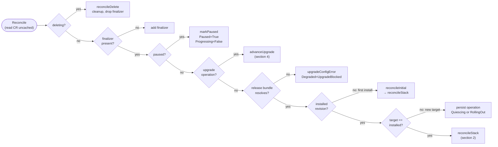
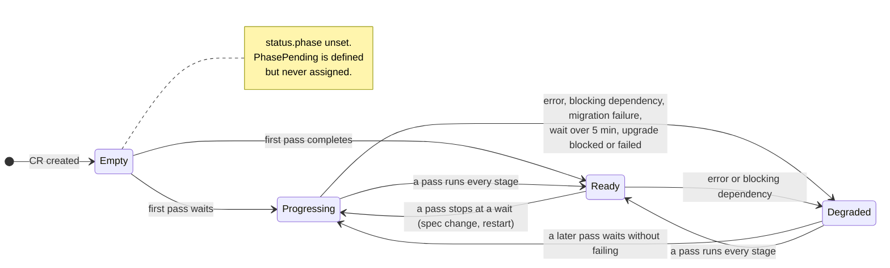
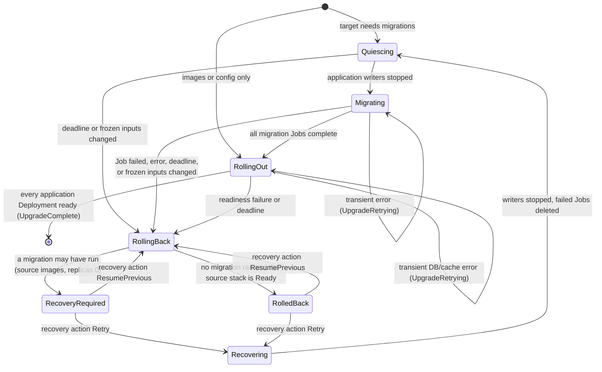

# CMSC status model: phase, conditions and transitions

How the operator moves `CostManagementServiceConfig` status: the reconcile
dispatch, the stage pipeline and what each stage writes, the `status.phase`
state machine, the upgrade operation state machine (COST-7693), and a reference
of every condition and Event.

The code is authoritative; this document describes it as of COST-8103. When the
two disagree, fix this document. Key files:

| Concern | Code |
|---------|------|
| Condition types, `Phase` enum | `api/v1alpha1/costmanagementserviceconfig_types.go` |
| Upgrade stages | `api/v1alpha1/upgrade_types.go` |
| Entry point, pipeline, stages | `internal/controller/costmanagementserviceconfig_controller.go` (`Reconcile`, `phases()`, `reconcileStack`, `reconcile*`) |
| Dispatch and upgrade operation | `internal/controller/upgrade_lifecycle.go` (`reconcile`, `advanceUpgrade`) |
| Quiesce and final rollout wait | `internal/controller/upgrade_workloads.go` |
| Validation probes | `internal/controller/validation*.go` |

Why conditions and not a phase enum: [design-vs-jira.md §1](design-vs-jira.md).
Upgrade behaviour in prose: [application-upgrades.md](application-upgrades.md).

## Ground rules

- **Conditions are the API.** `Available`, `Progressing` and `Degraded` are the
  top-level conditions; component conditions (`DatabaseReady`, `UIReady`, ...)
  explain them. `status.phase` is a one-word summary for `oc get cmsc`.
- **One status write per pass.** Stages mutate the CR in memory; `Reconcile`
  patches status once at the end (`patchStatus`). Only the end-of-pass value of
  a field is ever visible.
- **`lastTransitionTime` changes only when `status` changes.** Rewriting the
  same status with a new reason or message keeps the timestamp, so a wait loop
  does not look like a flap.
- **Events fire on transitions.** Each Event is guarded on the status read at
  the start of the pass (the CR is read uncached for this reason), so a healthy
  steady state emits nothing.

## 1. Reconcile dispatch

Every outcome ends the pass with one status patch. `reconcile()` (in
`upgrade_lifecycle.go`) owns everything right of the pause check.

- **target == installed** means the resolved revision equals the installed one
  and no migration Job needs to run; otherwise an operation is persisted
  (`Quiescing` when migrations are needed, else `RollingOut`) with
  `Progressing=True/UpgradePlanned`, before any child resource changes.
- **First install:** `reconcileInitial` runs `reconcileStack` and records the
  installed revision once the CR is Ready.
- A missing workload image short-circuits straight to `reconcileStack`, whose
  first stage reports it (`Degraded=True/ImageNotSet`).

## 2. The stage pipeline (`reconcileStack`)

`reconcileStack` sets `Phase=Progressing` and `Progressing=True/Reconciling`,
then runs `phases()` in order. A stage either continues (zero result), stops
the pass and requeues (a wait or a blocking failure), stops without requeue
(`Stop`), or returns an error. When every stage continues, the pass ends with
`markReady` and `completeProgressing` (last row of the table).

Any stage can end the pass early. An **error** sets
`Degraded=True/ReconcileError` (or `ImageNotSet`), `Phase=Degraded`, emits a
Warning Event and requeues after 30 s. A **wait or blocking failure** keeps the
conditions the stage set and requeues after 10–30 s (or the readiness backoff).
The table says which stages wait or block, and on what.

| # | Stage (`phases()`) | Conditions written | Stops the pass when | Events |
|---|--------------------|--------------------|---------------------|--------|
| 0 | `reconcileWorkloadImages` | — | a required `spec.*.image` is empty (error → `ImageNotSet`) | `ImageNotSet` (Warning) |
| 1 | `reconcileDiscovery` (skipped while an upgrade operation exists) | `DiscoveryComplete`, `StorageReady` (S3 discovery) | cluster domain / StorageClass not found | `DiscoveryComplete` |
| 2 | `reconcileSharedConfig` | — | API errors only | — |
| 3 | `reconcileInfrastructure` | `DatabaseReady`, `CacheReady` — **bundled only** (`WaitingFor*` / `*Available`); `StorageConfigChanged` on a PostgreSQL volume change | bundled pod not ready; storage change (`Phase=Degraded`) | `StorageConfigChanged` (Warning) |
| 4 | `reconcileValidation` | `DatabaseReady`, `CacheReady` — **external only**; `KafkaReady`, `StorageReady`, `AuthenticationReady` (non-blocking) | external DB/cache unreachable or its Secret invalid: `Available=False/DependencyNotReady`, `Degraded=True/DependencyUnreachable`, `Phase=Degraded`, requeue 30 s | `DependencyFailed` (Warning, on the transition to False); `InfrastructureReady` (once DB and cache become ready, emitted after this stage) |
| 5 | `reconcileMigration` (skipped by upgrade rollout/rollback) | `SchemaUpToDate`, `UpgradeFailed=False/MigrationComplete`, `Degraded=False/MigrationSucceeded` | Job running (wait); Job failed or migration image missing (`Stop`, `Phase=Degraded`) | `MigrationStarted`, `MigrationsComplete`, `MigrationFailed` + `UpgradeFailed` (Warning) |
| 6 | `reconcileCoreServices` | `ROSEnabled`, `RBACWorkerReady`, `RBACReady`, `CoreServicesReady`; `Available=False` with `WaitingForRBAC` / `WaitingForAPI` / `WaitingForMasu` / `WaitingForListener` / `WaitingForKruize`, then `WaitingForComponents` | RBAC API or a core Deployment not ready | — |
| 7 | `reconcileWorkers` | `IngressReady`; `Available=False/WaitingForROSAPI` / `WaitingForROSProcessor` | Ingress or ROS Deployment not ready | — |
| 8 | `reconcileEdge` | `GatewayReady`, `UIReady` | Envoy or its Route not ready; UI Deployment not ready (`Available=False/WaitingForUI`); UI OAuth client Secret missing or invalid, or UI Route not admitted (`UIReady` and `Available` False with the same reason: `OAuthClientSecretMissing`, `OAuthClientSecretInvalid`, `RouteNotAdmitted`; no 5-minute `Degraded` escalation) | — |
| 9 | `reconcileMonitoring` | — | API errors only | — |
| 10 | `waitForApplicationRollout` | `Available=False/WaitingForApplicationRollout` | any application Deployment (UI, Celery, Beat, RBAC worker, Envoy, Ingress, ROS) not rolled out, or old Pods still terminating | — |
| — | end of pass | `Available=True/AllComponentsReady`, `Degraded=False/ReconcileComplete`, `Progressing=False/ReconcileComplete` | — | `Ready` and `PhaseChanged` (on the transition) |

**Readiness timeout.** Every Deployment wait goes through `notReadyWait`. While
no upgrade operation exists, a wait that keeps `Available=False` with the same
reason for 5 minutes (`readinessTimeout`) also sets
`Degraded=True/DeploymentNotReady` ("<component> is not ready") and
`Phase=Degraded`, then backs off 30 s → 1 m → 2 m → 5 m. When the Deployment
recovers, the same wait sets `Degraded=False/DeploymentReady`. During an upgrade
operation this timer is suppressed; the operation's own deadline applies.

**Who owns `DatabaseReady` / `CacheReady`.** Infrastructure writes them for the
bundled components it deploys; validation writes them for external ones,
because validation is the stage that probes. Only one stage writes a given
condition in a pass, so the `DependencyFailed` and `InfrastructureReady`
transition guards hold during an outage.

## 3. `status.phase`

- `Paused` is not a phase: a paused CR keeps its last phase, with
  `Paused=True` and `Progressing=False/Paused`.
- `reconcileStack` resets the in-memory phase to `Progressing` at the start of
  every pass, so the visible phase is always the result of the latest pass.
- `PhaseChanged` is emitted for transitions into `Ready` and `Degraded`.

### Top-level conditions per situation

| Situation | Phase | `Available` | `Progressing` | `Degraded` |
|-----------|-------|-------------|---------------|------------|
| Install or change in progress, waiting on a stage | Progressing | False / `Waiting*` (unset before stage 6 on a fresh install) | True / `Reconciling` | unchanged |
| Steady state | Ready | True / `AllComponentsReady` | False / `ReconcileComplete` | False / `ReconcileComplete` |
| A wait lasted 5 min (no upgrade) | Degraded | False / `Waiting*` | True / `Reconciling` | True / `DeploymentNotReady` |
| UI OAuth client Secret missing or invalid, or UI Route not admitted | Progressing | False / `OAuthClientSecretMissing`, `OAuthClientSecretInvalid` or `RouteNotAdmitted` | True / `Reconciling` | unchanged |
| External DB or cache unreachable | Degraded | False / `DependencyNotReady` | True / `Reconciling` | True / `DependencyUnreachable` |
| Stage error (API error, missing image) | Degraded | unchanged | True / `Reconciling` | True / `ReconcileError` or `ImageNotSet` |
| Migration Job failed (no upgrade operation) | Degraded | False / `MigrationFailed` | False / `MigrationFailed` | True / `MigrationFailed` |
| Migration image missing | Degraded | False / `ImageNotSet` | False / `ImageNotSet` | True / `ImageNotSet` |
| Bundled PostgreSQL storage changed | Degraded | False / `StorageConfigChanged` | False / `StorageConfigChanged` | True / `StorageConfigChanged` |
| Release bundle or transition invalid | Degraded | False / `UpgradeBlocked` | False / `UpgradeBlocked` | True / `UpgradeBlocked` |
| Upgrade quiescing or migrating | Progressing | False / `UpgradeMaintenance` | True / `UpgradeMaintenance` | unchanged |
| Upgrade retrying after a transient error | Progressing (Degraded if `Degraded=True`) | False / `UpgradeRetrying` | True / `UpgradeRetrying` | unchanged |
| Upgrade failed, recovery required | Degraded | False / `RecoveryRequired` | False / `RecoveryRequired` | True / `UpgradeFailed` |
| Upgrade failed, source restored | Degraded | True / `AllComponentsReady` | False / `RolledBack` | True / `UpgradeFailed` |
| Paused | unchanged | unchanged | False / `Paused` | unchanged |

## 4. Upgrade operation (`status.upgrade.operation.stage`)

An operation is persisted before any child resource changes and is advanced
one stage per pass by `advanceUpgrade`. It is cleared only when a rollout
completes.

| Stage | Top-level status | Notes |
|-------|------------------|-------|
| `Quiescing`, `Migrating` | `Phase=Progressing`, `Available=False/UpgradeMaintenance`, `SchemaUpToDate=False/MigrationPending` then `MigrationRunning` | Application Deployments scaled to 0 and schedules suspended before any Job runs. `Migrating` re-runs shared config, infrastructure and validation as a preflight. |
| `RollingOut` | as for the pipeline (section 2), migration stage skipped | The 5-minute readiness timer is off; `spec.upgrade.timeoutSeconds` (default 7200) applies to the whole operation. |
| `RollingBack` | `UpgradeFailed=True/UpgradeFailed`, `Available=False/RollingBack` | Waits for migration writers to stop before restoring the source revision. |
| `RecoveryRequired` | `Phase=Degraded`, `RecoveryRequired=True/SchemaStateUnknown`, `Degraded=True/UpgradeFailed` | Source images restored with replicas at 0; needs `spec.upgrade.recovery`. |
| `RolledBack` | `Phase=Degraded`, `Available=True`, `UpgradeFailed=True`, `Degraded=True/UpgradeFailed` | Source revision running; the requested target is still failed. |
| `Recovering` | as `Quiescing` | Accepted `Retry`; deletes failed migration Jobs after writer exclusion. |

`RecoveryRequired` and `RolledBack` are holds: editing image tags or restarting
the operator does not leave them; only a recovery request bound to the
operation ID does (see [application-upgrades.md](application-upgrades.md)).

## 5. Condition reference

| Condition | Written by | True reasons | False reasons |
|-----------|------------|--------------|---------------|
| `Available` | core, worker, edge and rollout waits; `markReady`; validation; migration; upgrade | `AllComponentsReady` | `Waiting*` (one per Deployment wait), `WaitingForComponents`, `WaitingForApplicationRollout`, `OAuthClientSecretMissing`, `OAuthClientSecretInvalid`, `RouteNotAdmitted` (UI gates), `DependencyNotReady`, `MigrationFailed`, `MigrationPending`, `ImageNotSet`, `StorageConfigChanged`, `UpgradeBlocked`, `UpgradeMaintenance`, `UpgradeRetrying`, `RollingBack`, `RecoveryRequired` |
| `Progressing` | `reconcileStack`, `completeProgressing`, `markPaused`, upgrade | `Reconciling`, `UpgradePlanned`, `UpgradeMaintenance`, `UpgradeRetrying`, `LegacyBaselineAdopted` | `ReconcileComplete`, `Paused`, `MigrationFailed`, `ImageNotSet`, `StorageConfigChanged`, `UpgradeBlocked`, `RecoveryRequired`, `RolledBack` |
| `Degraded` | `reconcileStack` (errors), `notReadyWait`, validation, migration, upgrade, `markReady` | `ReconcileError`, `ImageNotSet`, `DeploymentNotReady`, `DependencyUnreachable`, `MigrationFailed`, `StorageConfigChanged`, `UpgradeBlocked`, `UpgradeFailed` | `ReconcileComplete`, `MigrationSucceeded`, `DeploymentReady`, `LegacyBaselineAdopted` |
| `DiscoveryComplete` | discovery | `Discovered` | `ClusterDomainNotFound`, `StorageClassNotFound` |
| `StorageReady` | discovery, validation (non-blocking) | `Discovered`, `UserProvided`, `StorageBucketsAccessible` | `S3NotFound`, `StorageSecretInvalid`, `StorageCACertInvalid`, `StorageUnreachable`, `StorageBucketInaccessible`, `StorageBucketConfigInvalid` |
| `DatabaseReady` | infrastructure (bundled), validation (external) | `DatabaseAvailable`, `DatabaseReachable` | `WaitingForDatabase`, `StorageConfigChanged`, `DatabaseUnreachable`, `DatabaseSecretInvalid` |
| `CacheReady` | infrastructure (bundled), validation (external) | `CacheAvailable`, `CacheReachable` | `WaitingForCache`, `CacheUnreachable`, `CacheSecretInvalid` |
| `KafkaReady` | validation (non-blocking) | `KafkaContractValid` | bootstrap missing, unreachable, auth failed, topic missing, TLS/SASL config invalid |
| `AuthenticationReady` | validation (non-blocking) | `OIDCReachable` | `OIDCConfigMissing`, `OIDCCACertInvalid`, `OIDCUnreachable` |
| `SchemaUpToDate` | migration, upgrade | `MigrationComplete`, `SourceRestored` | `MigrationPending`, `MigrationRunning`, `MigrationFailed`, `ImageNotSet` |
| `UpgradeFailed` | migration, upgrade | `MigrationFailed`, `UpgradeFailed` | `MigrationComplete`, `UpgradeComplete` |
| `RecoveryRequired` | upgrade | `SchemaStateUnknown` | `SourceRestored`, `UpgradeComplete` |
| `ROSEnabled` | core (feature flag, not health) | `Enabled` | `Disabled` |
| `RBACWorkerReady` | core | `RBACWorkerAvailable` | `WaitingForRBACWorker` |
| `RBACReady` | core | `RBACAvailable` | `WaitingForRBAC` |
| `CoreServicesReady` | core | `CoreServicesAvailable` | mirrors the blocking core wait reason, `WaitingForRBAC` |
| `IngressReady` | workers | `IngressReady` | `WaitingForIngress` |
| `GatewayReady` | edge | `GatewayReady` | `WaitingForGateway`, `ClusterDomainPending`, `RouteNotAdmitted` |
| `UIReady` | edge | `UIAvailable` (UI Deployment ready) | `OAuthClientSecretMissing`, `OAuthClientSecretInvalid`, `RouteNotAdmitted`, `WaitingForUI` |
| `Paused` | `Reconcile` | `AnnotationSet` | `Resumed` |

`RBACWorkerReady` does not stop stage 6, but the RBAC worker Deployment is part
of the final rollout wait (stage 10), so it gates `Available=True`.

## 6. Events

| Event | Type | When |
|-------|------|------|
| `DiscoveryComplete` | Normal | `DiscoveryComplete` becomes True |
| `InfrastructureReady` | Normal | `DatabaseReady` and `CacheReady` both become True (after validation, in the pipeline or the upgrade migration preflight) |
| `DependencyFailed` | Warning | an external DB/cache probe fails and the condition was not already False |
| `MigrationStarted` | Normal | a migration Job is created |
| `MigrationsComplete` | Normal | `SchemaUpToDate` becomes True |
| `MigrationFailed`, `UpgradeFailed` | Warning | a migration Job exhausts retries (once per Job UID); `UpgradeFailed` also when an upgrade operation fails |
| `RecoveryRequired` | Warning | an operation enters `RecoveryRequired` |
| `UpgradeComplete` | Normal | an upgrade operation completes |
| `Ready` | Normal | a pass completes from a non-Ready phase (not during a rollback hold) |
| `PhaseChanged` | Normal | phase changes into `Ready` or `Degraded` |
| `Paused` | Normal | the pause annotation is first observed |
| `ReconcileError`, `ImageNotSet` | Warning | a stage returns an error (every failing pass) |
| `StorageConfigChanged` | Warning | the bundled PostgreSQL volume size or class changed |

## 7. Known gaps

- `PhasePending` is never assigned; a new CR shows an empty phase until its
  first pass is patched.
- The Gateway (stage 8) and Ingress (stage 7) waits set only their own
  condition and requeue; they do not touch `Available` and stop the pass
  before the final rollout wait. A crash-looping Envoy or Ingress after Ready
  shows `Phase=Progressing` while `Available` stays True
  ([code-review-fixmes.md](../code-review-fixmes.md) D1).
- A stage error leaves `Available` unchanged while setting `Degraded=True` and
  `Phase=Degraded`.
- `failUpgrade` does not set the phase; the `RollingBack` pass keeps whatever
  phase the failing pass left until `rollbackUpgrade` sets `Degraded`.
- `NewPhaseError` has no callers, so `applyPhaseError` never matches; stage
  errors are reported only through the `ReconcileError` / `ImageNotSet` path.
