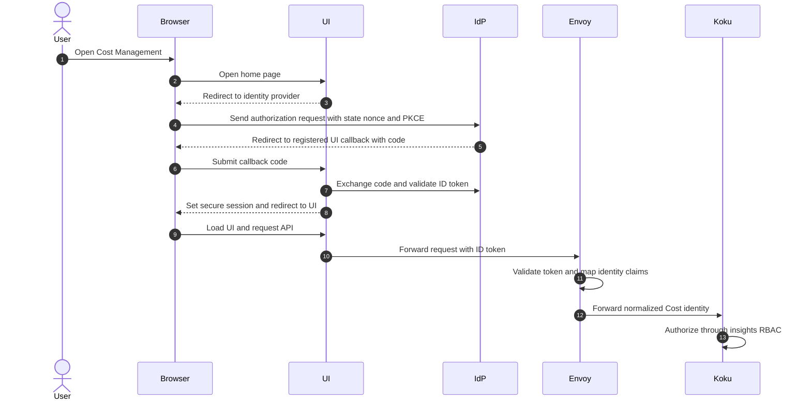
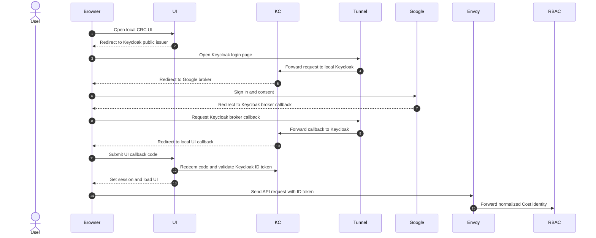

# Proposed design: provider-neutral OIDC for Cost Management on-prem

**Status:** Proposed design for COST-8520; no implementation has started

**Scope:** UI login, Envoy JWT validation, and Cost identity claims

**Plan:** See [PLAN.md](PLAN.md)

## Executive proposal

Add provider-neutral OIDC mode beside the existing Keycloak mode. Keep the existing Keycloak API and behavior intact for installed clusters. In OIDC mode, oauth2-proxy performs browser login using OIDC discovery; Envoy validates the ID token with an explicit issuer, audience, and JWKS URL; Envoy maps configured claims into the existing Cost Management identity header.

This is authentication integration. The external provider proves who signed in; insights-rbac remains the authorization system. OIDC does not define Cost tenant identifiers, RBAC roles, or user/group provisioning. The operator must therefore require explicit tenant/admin claim mapping or explicit single-tenant values. It must never infer organization identity or admin rights from an email address or hosted-domain claim.

For the first end-to-end experiment, Google brokering through the existing Keycloak is the lowest-change path. It exercises the current UI and Cost claim contract, but still depends on Keycloak and does not complete COST-8520. Product acceptance must exercise direct OIDC.

[COST-8520](https://redhat.atlassian.net/browse/COST-8520) describes an external OIDC provider as an alternative to Keycloak but does not settle the claim, tenant, administrator, or provisioning contract. This document proposes those choices for review. Related work includes [COST-8430](https://redhat.atlassian.net/browse/COST-8430) and [COST-7895](https://redhat.atlassian.net/browse/COST-7895).

## Goals and non-goals

Goals:

- Allow an OpenID Connect provider to replace Keycloak for interactive UI login and JWT authentication at Envoy.
- Preserve the X-Rh-Identity contract consumed by Koku and insights-rbac.
- Configure issuer, JWKS, audience, TLS, and Cost identity mappings without provider-specific implementation code.
- Keep Keycloak-configured clusters working without CR edits.
- Report useful AuthenticationReady status for invalid OIDC configuration, unavailable discovery/JWKS, and TLS failures.
- Support CRC testing without a public IP using a short-lived public tunnel to the required web endpoint only.

Non-goals:

- Replacing insights-rbac or moving role/group authorization to the identity provider.
- Automatically importing arbitrary provider users and groups. OIDC has no standard provisioning API; the current sync job speaks the Keycloak Admin API.
- Treating Google email, Google Workspace hd, or another default profile claim as a Cost tenant or administrator role.
- Adding service-account or OAuth client-credentials identity semantics. The current gateway constructs a User identity. If COST-8520 requires service-account tokens, define a separate contract for subject, audience, tenant, and RBAC lifecycle.
- Using a public tunnel in production.

## Current behavior and constraints

### Configuration and UI login

The CR exposes spec.auth.keycloak and has no provider-neutral OIDC object. The schema requires spec.auth.keycloak.url. See [AuthConfig and KeycloakSpec](../../api/v1alpha1/costmanagementserviceconfig_types.go#L316-L376) and the [top-level CEL requirement](../../api/v1alpha1/costmanagementserviceconfig_types.go#L701-L704).

The UI Deployment hardcodes oauth2-proxy's Keycloak provider, builds the redirect URI from the UI Route host, and builds logout from Keycloak's logout endpoint. The OAuth client ID and secret already come from a Secret reference. See [UIDeployment](../../internal/resources/ui.go#L146-L194), [UIRoute](../../internal/resources/ui.go#L323-L355), and [UIConfig](../../api/v1alpha1/costmanagementserviceconfig_types.go#L632-L640).

oauth2-proxy can use its generic OIDC provider and pass its ID token as the Authorization bearer token. Envoy needs that signed ID token; the design must not substitute an opaque provider access token. See the [oauth2-proxy provider documentation](https://oauth2-proxy.github.io/oauth2-proxy/configuration/providers/) and [header option reference](https://oauth2-proxy.github.io/oauth2-proxy/7.12.x/configuration/overview/#header-options).

### Envoy validation and identity translation

Envoy currently validates a JWT using a Keycloak-derived issuer, Keycloak JWKS URL, and configured audiences. The issuer and key-fetch URL are intentionally separate: the issuer may be public while JWKS remains on the in-cluster Keycloak Service. See [Keycloak URL, issuer, and JWKS helpers](../../internal/resources/envoy.go#L27-L80).

Envoy's JWT filter does not perform OIDC discovery. Its provider needs an explicit issuer, audience list, and JWKS URI. See the [Envoy JWT authentication filter documentation](https://www.envoyproxy.io/docs/envoy/latest/configuration/http/http_filters/jwt_authn_filter.html).

After signature, issuer, and audience verification, the Lua filter requires org_id and account_number; reads preferred_username or sub and email; grants admin only when realm_access.roles contains org-admin; and writes X-Rh-Identity. Missing tenant claims fail closed with 401. See [the identity translation code](../../internal/resources/envoy.go#L605-L695).

### Readiness and RBAC provisioning

The current [OIDC readiness probe](../../internal/controller/validation.go#L164-L189) probes the Keycloak JWKS endpoint. It does not prove oauth2-proxy discovery, browser redirect, code exchange, or login.

The [Keycloak sync CronJob](../../internal/resources/rbac_keycloak_sync.go#L33-L64) uses Keycloak's Admin API and client secret to sync groups/principals. It is separate from gateway authentication. The [Keycloak install and authorization guide](../install/keycloak.md#authorization) explains that the realm role drives admin_default permissions and group synchronization is separate.

Direct OIDC removes that sync source unless a customer keeps Keycloak for provisioning. The v1 proposal does not invent a generic sync API. Before implementation is accepted, confirm how a non-admin user becomes selectable and assignable in the RBAC UI when Keycloak sync is disabled.

## Proposed API shape

Add spec.auth.oidc as an additive sibling of spec.auth.keycloak. Keep the existing Keycloak fields unchanged. Require exactly one active mode: the Keycloak URL remains required when OIDC is absent; reject a CR that configures both providers.

The following is a conceptual example; field names are proposals, not an implemented API:

    spec:
      auth:
        oidc:
          issuerURL: https://idp.example.com/realms/cost
          jwksURL: https://idp.example.com/realms/cost/protocol/openid-connect/certs
          audiences:
            - cost-management-ui
          tls:
            caCertSecretName: external-idp-ca
          identity:
            orgID:
              claim: /org_id
            accountNumber:
              claim: /account_number
            username:
              claim: /preferred_username
            email:
              claim: /email
            orgAdmin:
              claim: /groups
              value: cost-management-admin

The confidential client ID and secret continue to come from spec.ui.oauthClientSecretRef, whose Secret contains client-id and client-secret. The audiences must include the ID token's client audience. Decide whether the operator validates this against the Secret's client ID or requires the same value in both places.

### Provider and TLS fields

- issuerURL: exact ID-token issuer and oauth2-proxy discovery issuer; require HTTPS in normal configurations.
- jwksURL: explicit HTTPS key-set endpoint for Envoy. It may be a private/in-cluster URL if supported by the provider. Validate it independently from issuerURL.
- audiences: non-empty. Never disable audience validation when this list is omitted.
- tls.caCertSecretName: optional Secret containing ca.crt, mounted for oauth2-proxy and used by Envoy's JWKS cluster/readiness probe.
- tls.insecureSkipVerify: retain only as a clearly marked lab escape hatch; do not use it in production examples.
- Keep client credentials in a Kubernetes Secret. Never put them in the CR, ConfigMap, Deployment arguments, Events, or status.

OIDC discovery is for oauth2-proxy login. Envoy uses the explicit jwksURL. Readiness may also compare discovery metadata to catch an issuer/JWKS mismatch, but Envoy configuration must contain a concrete JWKS endpoint.

### Cost identity mapping

Map a small, validated set of claims to the existing identity schema. For orgID and accountNumber, allow either a claim path or a fixed value for an explicitly single-tenant installation; require exactly one source per field. Use documented JSON Pointer syntax for nested claim paths.

For username and email, allow claim paths and define safe fallbacks to sub and a synthetic/empty email consistently with current behavior. For orgAdmin, require a claim path plus an expected value or boolean interpretation. If the claim is absent or does not match, set is_org_admin to false. Do not allow a static orgAdmin: true setting.

Continue applying the current identifier length/character validation to mapped tenant values. If a required mapped value is missing, has the wrong type, or is invalid, return 401 and do not forward a partially normalized identity.

The existing [Keycloak mapper contract](../install/keycloak.md#protocol-mappers-required-claims) documents Cost's current custom claims. A generic provider may emit none of them. Direct Google login therefore needs explicit single-tenant org/account values for a non-admin smoke test, and a trusted admin claim from a provider or broker for the admin path. Email and hd are not admin signals.

### Backward-compatible runtime behavior

- With only spec.auth.keycloak configured, preserve current oauth2-proxy, Envoy, TLS, readiness, logout, and optional Keycloak sync behavior.
- With only spec.auth.oidc configured, use oauth2-proxy's generic OIDC provider, the configured issuer/JWKS/audiences/CA, and the provider-neutral claim mapper.
- Reject both providers configured together to avoid ambiguous issuer and logout behavior.
- For generic logout, use OIDC discovery's end_session_endpoint only when the provider publishes one and oauth2-proxy supports it. Otherwise clear the local session and document that the IdP session may remain.
- Keep spec.rbac.keycloakSync explicitly Keycloak-specific. Enabling it may still require a Keycloak provisioning endpoint; direct OIDC must not imply generic user/group sync. Product acceptance must state whether this limitation is acceptable.

## Direct OIDC request flow

In production the callback is the configured public UI endpoint. In CRC, direct Google login needs a public HTTPS callback that tunnels back to the local UI. The current operator derives the callback only from the OpenShift Route, so testability requires an explicit external callback/base URL or a controlled temporary override. The plan includes that prerequisite.

## CRC testing: Keycloak broker baseline and direct OIDC acceptance

### Lowest-change baseline: Google through local Keycloak

This is the first browser test to run because Keycloak already emits the Cost claims Envoy expects. Google is an upstream identity broker; Keycloak remains the issuer trusted by the UI and Envoy.

The tunnel only needs to expose Keycloak's browser-facing web endpoints. The browser can return to the CRC UI route because it is on the developer's machine. Keycloak's frontend hostname/issuer must be the public tunnel hostname so its discovery metadata and token issuer agree. See [Keycloak hostname configuration](https://www.keycloak.org/server/hostname).

The [RHBK deploy helper](../../scripts/deploy-rhbk.sh#L637-L685) derives the Keycloak hostname from the CRC cluster domain. This test needs a temporary hostname override on the Keycloak custom resource or an optional helper override in a later, separate change. Set the CMSC issuer to the public issuer while keeping Envoy's JWKS fetch on the in-cluster Service where practical; see the existing [issuer/JWKS split](../../internal/resources/envoy.go#L45-L73).

### Tunnel choice and Google Console constraint

Use ngrok's assigned stable dev domain as the first candidate because it remains the same when the agent restarts. It is provider-owned, so first confirm Google Cloud Console accepts it for the testing OAuth client. Google policy says redirect URIs must refer to domains the developer owns, is authorized to use, or licensed to use; HTTPS is required except for localhost; and the callback must exactly match the registered URI. See Google's [web-server OAuth redirect rules](https://developers.google.com/identity/protocols/oauth2/web-server) and [OAuth policy](https://developers.google.com/identity/protocols/oauth2/policies).

If Console verification rejects the assigned ngrok domain, use a custom domain you control and point it at the tunnel, or another test-domain arrangement approved for the Google project. Do not base repeatable setup on a hostname that cannot be registered. Cloudflare Quick Tunnels are useful for a reachability smoke test, but their hostname changes each run and the endpoint is public while active; see [Quick Tunnel behavior and limits](https://developers.cloudflare.com/tunnel/get-started/quick-tunnels/). ngrok documents its [stable dev domain](https://ngrok.com/docs/gateway/domains) and [Host-header rewrite support](https://ngrok.com/docs/gateway/endpoints/http#rewriting-the-host-header).

Run the tunnel agent on the laptop with an outbound connection and forward only the required Keycloak web endpoint. Do not expose the OpenShift API, Keycloak Admin Console/API, database, Kafka, Envoy, or unrelated CRC routes. Do not put an interactive auth wall in front of OIDC authorization/callback paths. Use a test Google account and synthetic tenant; stop the tunnel after testing.

### Direct-provider acceptance on CRC

The broker baseline cannot prove direct provider support. After implementation, expose the UI callback through a public HTTPS tunnel and register the exact public callback in Google Cloud Console. The tunnel must route callback traffic to oauth2-proxy, preserve the state/cookie round trip, and send normal UI/API traffic to the same local application. Keep the tunnel limited to that UI endpoint. If a stable provider-owned hostname cannot be authorized, use a domain you control.

Google's standard OIDC profile does not supply Cost org_id, account_number, or org-admin by default. For direct Google smoke testing, configure explicit single-tenant org/account values and verify admin remains false. Test positive admin mapping separately with a trusted IdP or a Keycloak-brokered token carrying the documented Cost claim. Email-domain membership must not grant admin rights.

## Trust boundaries and failure behavior

| Boundary | Required behavior |
|---|---|
| Browser to UI | HTTPS, secure cookie, exact callback URI, state/nonce/PKCE validation supported by the pinned oauth2-proxy image |
| UI proxy to IdP | HTTPS discovery/token endpoints, CA validation, client secret mounted from Secret |
| UI proxy to Envoy | Forward the ID token; strip or replace caller-supplied identity headers |
| Envoy JWT filter | Require signature, exact issuer, configured audience, exp/nbf validity, and remote JWKS |
| Envoy identity mapper | Require valid org/account; admin false unless the configured trusted claim matches |
| Tunnel to CRC | Outbound agent only; temporary minimum web route; no control plane or data services |
| RBAC principal provisioning | Do not claim provider sync unless a supported provisioning contract exists |

Discovery, code exchange, signature, issuer, audience, expiry, or JWKS failures must fail closed. Claim-mapping failures must return 401 before a Koku/RBAC request is sent. Readiness must distinguish bad config, provider/JWKS unreachability, and TLS errors without logging tokens, client secrets, or authorization codes.

## Decisions to settle before implementation

1. Tenant identity: provider claims only, or explicit fixed values for single-tenant installs? Proposal: allow either, exactly one source per org/account field.
2. Admin claim: boolean, scalar role, or group array? Proposal: explicit claim plus expected value; missing means non-admin.
3. Principal/group lifecycle: can this ship without generic provider sync? Identify how first admin and regular users are represented in RBAC when Keycloak sync is disabled.
4. Google audience: entered separately, or derived/validated against the UI Secret client ID?
5. Logout: is local session clearing enough when the provider has no end-session endpoint?
6. Callback customization: add an external UI base/callback URL for tunnels and reverse proxies, or test only through an operator-owned Route hostname?
7. Service accounts: confirm out of scope for browser OIDC or provide a separate contract.
8. Ticket acceptance: agree with COST-8520/COST-8430 owners because ticket descriptions do not currently settle these contracts.

## References

- [COST-8520](https://redhat.atlassian.net/browse/COST-8520), [COST-8430](https://redhat.atlassian.net/browse/COST-8430), [COST-7895](https://redhat.atlassian.net/browse/COST-7895)
- [Google OpenID Connect](https://developers.google.com/identity/openid-connect/openid-connect)
- [Google OAuth web-server flow and redirect rules](https://developers.google.com/identity/protocols/oauth2/web-server)
- [Google OAuth policy](https://developers.google.com/identity/protocols/oauth2/policies)
- [oauth2-proxy provider configuration](https://oauth2-proxy.github.io/oauth2-proxy/configuration/providers/)
- [Envoy JWT authentication filter](https://www.envoyproxy.io/docs/envoy/latest/configuration/http/http_filters/jwt_authn_filter.html)
- [Keycloak hostname configuration](https://www.keycloak.org/server/hostname)
- [ngrok domains](https://ngrok.com/docs/gateway/domains) and [HTTP Host rewrite](https://ngrok.com/docs/gateway/endpoints/http#rewriting-the-host-header)
- [Cloudflare Quick Tunnels](https://developers.cloudflare.com/tunnel/get-started/quick-tunnels/)
