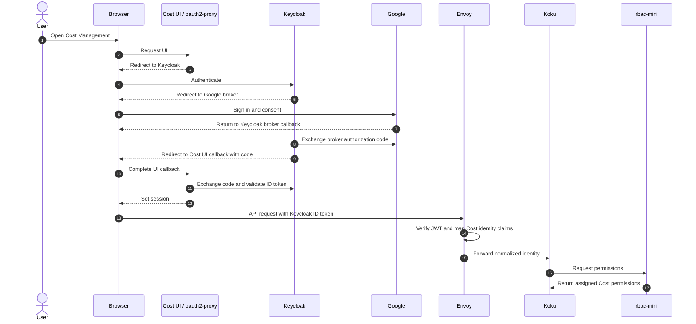
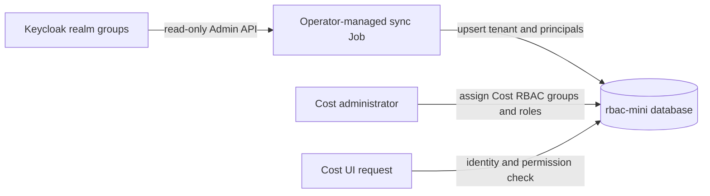

# Keycloak broker and rbac-mini setup

**Status (2026-11-19):** The Google → Keycloak → rbac-mini path and operator setup helper were exercised on a fresh ClusterBot cluster. The first browser callback returned HTTP 500 because Keycloak had not marked the Google user's email verified; enabling Trust Email and verifying that existing user's email allowed a subsequent login to succeed. Cost then returned no access because the principal has no Cost permissions. The latest inspection found the user's tenant attributes set but no membership in `/org-1234567`; see the [rerun record](CLUSTERBOT-PREP.md#fresh-clusterbot-rerun-2026-11-19).

**Purpose:** Repeat the existing Keycloak broker path and use the operator's `go` RBAC backend with the [rbac-mini project](https://github.com/project-koku/rbac-mini).

**COST-8520 boundary:** This guide covers the compatibility/test path that keeps Keycloak. It does not implement the ticket's direct OIDC goal, which is to let customers remove Keycloak; see [DESIGN.md](DESIGN.md) and [PLAN.md](PLAN.md).

## Request and sync flows

The browser path authenticates through Keycloak. The operator's separate sync Job reads tenant-group membership from Keycloak's Admin API and creates rbac-mini principals. Neither Keycloak group membership nor login grants Cost roles.





## What the ClusterBot test established

- Google sign-in through Keycloak succeeded; the user had `org_id=1234567`, `account_number=7890123`, membership in `/org-1234567`, and no `org-admin` realm role.
- The sync service account needed `query-groups`, `query-users`, `view-realm`, and `view-users` from the `realm-management` client. With `fullScopeAllowed=false`, the token also needed the built-in `roles` scope, a dedicated `kc-admin-api` client scope mapping those four roles, and a `realm-management` audience mapper.
- The one-off rbac-mini sync created an active principal. `GET /access/` returned no permissions because the user had no Cost RBAC assignment. The Cost UI showed “You do not have access to Cost management.”
- The Keycloak `org-*` group discovers the tenant and principals. It does not grant Cost roles. An administrator must assign the user to a Cost RBAC group that has the appropriate role.
- The tested image was an architecture-specific ClusterBot build. Do not use a personal test image for a customer deployment; use an approved rbac-mini image that matches the cluster architecture.

The detailed rerun evidence, CMSC fields, image digest, and verification commands are in the [rbac-mini rerun guide](https://github.com/project-koku/rbac-mini/blob/main/doc/KEYCLOAK-RBAC-MINI-RERUN.md) and [dated ClusterBot record](CLUSTERBOT-PREP.md#observed-rbac-go-backend-and-authorization-result-2026-11-18).

## Prerequisites

- An operator build whose CRD and controller support `spec.rbac.backend: go` and `spec.rbac.keycloakSync`.
- A Keycloak realm used by the Cost UI and an HTTPS Keycloak URL trusted by the machine running the setup helper. If the route uses a private CA, provide its CA bundle.
- A realm administrator that can manage clients, service accounts, client scopes, protocol mappers, and identity providers. The helper reads the generated RHBK admin Secret from the explicitly named cluster context, or prompts for the admin password. It never accepts a password as a command-line argument or environment variable.
- `python3`, `oc`, and permission to create and patch Secrets in the target namespace.
- A Google Web OAuth client if you want the script to configure Google as the upstream broker. Google OAuth client creation remains a Cloud Console step; see [Google Auth setup](GOOGLE-AUTH-SETUP.md).
- A built rbac-mini image for the target architecture. The beta `go` backend is experimental; see the [rbac-mini source](https://github.com/project-koku/rbac-mini).

## Configure Google and the sync client

The existing [Google project helper](../../scripts/oidc/prepare-google-oauth.sh) prints the Keycloak broker callback URI. Register that exact callback URI as an authorized redirect URI on a Google Web OAuth client in Cloud Console. Do not put the Google secret in the Cost UI OAuth Secret.

The new [Keycloak and rbac-mini setup helper](../../scripts/oidc/configure-keycloak-rbac-mini.py) uses the Keycloak Admin REST API. It can configure Google when `--google-client-id` is supplied, including Keycloak's **Trust Email** setting for Google's verified email claims; create or reconcile a dedicated `rbac-keycloak-sync` client; assign only the four required read roles; create/reconcile `kc-admin-api` with the `realm-management` audience; attach `roles` and `kc-admin-api` as default scopes; verify a client-credentials token; and apply the client secret as a namespace Secret with key `CLIENT_SECRET`. The helper keeps TLS verification enabled and does not print OAuth secrets or access tokens. See the [Keycloak Admin REST API reference](https://www.keycloak.org/docs-api/latest/rest-api/) for the API it calls.

Use an explicit context and namespace for the Secret write. For the test ClusterBot defaults:

```bash
export KUBECONFIG=/path/to/isolated-clusterbot.kubeconfig
CTX="$(oc config current-context)"
NS=cost-byoi
KEYCLOAK_HOST="$(oc --context="$CTX" -n keycloak get route keycloak -o jsonpath='{.spec.host}')"
GOOGLE_OAUTH_CLIENT_JSON=/path/to/google-oauth-client.json
python3 ./scripts/oidc/configure-keycloak-rbac-mini.py \
  --keycloak-url "https://$KEYCLOAK_HOST" \
  --realm kubernetes \
  --admin-secret-namespace keycloak \
  --admin-secret-name keycloak-initial-admin \
  --google-client-file "$GOOGLE_OAUTH_CLIENT_JSON" \
  --context "$CTX" \
  --namespace "$NS"
```

With an RHBK admin Secret, the helper reads its username and password from the explicitly selected context; this requires permission to read that Secret. For external Keycloak, pass --admin-user NAME and enter the password at the prompt. Google credentials can come from the OAuth client JSON downloaded from Cloud Console, or pass --google-client-id and enter its secret at the prompt. Keep the JSON outside the repository. To skip Google IdP changes and configure only the sync client, omit both Google options. To configure Keycloak without writing a Secret, pass --no-cluster-secret; use a protected secret-management workflow to install the resulting client credential. To trust a private Keycloak CA, pass --ca-cert /path/to/ca-bundle.pem; do not disable TLS verification.

The helper is safe to rerun for the dedicated client and scope. If the existing service-account role mapping or `kc-admin-api` scope contains extra `realm-management` roles, it stops and reports them instead of silently broadening or pruning an existing mapping. Use a dedicated client and scope; do not reuse them for another application. A failure after Keycloak configuration but before the Kubernetes Secret is applied may leave partial Keycloak state; rerun after correcting the reported issue.

### Manual Google Cloud Console step

Google OAuth Web client creation is still performed in Cloud Console. Add the exact callback printed by the helper (normally `https://<keycloak-host>/realms/kubernetes/broker/google/endpoint`). Keep the requested scopes to `openid`, `email`, and `profile`. Google may require a domain you own or are authorized to use; if it rejects the cluster route, use a domain approved for the test project.

## Set up a Google-linked Cost principal

After the user's first Google login creates or links the Keycloak user, use the realm's user settings to set `org_id` and `account_number` to values configured for the Cost tenant, then add the user to `/org-<org_id>`. The values `1234567` and `7890123` are synthetic ClusterBot test values, not customer defaults.

For an ordinary-user check, leave the Keycloak `org-admin` realm role and all Cost RBAC group/role assignments empty. For the administrator path, use a separately controlled account with the `org-admin` **realm role** so it can access User Access and delegate Cost roles. The Keycloak `org-admin` group subgroup is not an authorization grant; see the [Keycloak authorization guide](../install/keycloak.md#authorization).

## Select rbac-mini and run one sync

Set `spec.rbac.backend: go`, select the approved rbac-mini image and tag, and configure `spec.rbac.keycloakSync` with the same realm, sync client ID, and Secret created above. Use an explicit future CronJob schedule during a one-off test so enabling the feature does not unexpectedly start a periodic sync. Keep `pruneOrphans` enabled only when the `org-*` Keycloak groups are the source of truth; pruning removes principals no longer present in those groups. The [rbac-mini rerun guide](https://github.com/project-koku/rbac-mini/blob/main/doc/KEYCLOAK-RBAC-MINI-RERUN.md#switch-the-cmsc-and-run-one-sync) has the tested patch and manual Job commands.

Wait for the migration and API rollout, create one Job from the operator-managed sync CronJob, then save its Job YAML and logs before disabling sync. The operator removes the CronJob and can also remove the manually created Job when sync is disabled. Leave `backend: go` enabled for the UI check.

Verify that the synced user appears as an active rbac-mini principal and that `/access/` returns zero permissions before a Cost role is assigned. Then use the bootstrap administrator to assign a Cost RBAC group/role and verify that the user's access changes. The authentication provider establishes identity; rbac-mini/Insights RBAC remains the authorization system.

## Troubleshooting

| Symptom | Likely check |
|---|---|
| Google returns `redirect_uri_mismatch` | The Google client callback must exactly match Keycloak's `https://<host>/realms/<realm>/broker/<alias>/endpoint`. |
| Google sign-in returns to the Cost UI, then `/oauth2/callback` returns HTTP 500 | Inspect oauth2-proxy logs for `email in id_token ... isn't verified`. In the Keycloak realm, enable **Trust Email** on the Google identity provider. This trusts the provider's `email_verified` claim; it does not by itself repair an account already brokered with an unverified email. For that existing user, verify the Email setting only after confirming Google verifies the address. See the [Keycloak Trust Email behavior](https://www.keycloak.org/docs/latest/server_admin/) and [Google's `email_verified` claim](https://developers.google.com/identity/openid-connect/openid-connect). Start a new login from the Cost UI; the failed authorization code has already been consumed. Keep oauth2-proxy email verification enabled. This failure occurs before Cost RBAC authorization and is not fixed by adding Cost roles or tenant attributes. |
| Sync client gets HTTP 403 from Keycloak | Check the four service-account role mappings, `roles` and `kc-admin-api` default scopes, the custom scope role mappings, `realm-management` audience, and `fullScopeAllowed=false`. |
| Google login succeeds but the Cost UI rejects access | Confirm tenant claims and `/org-<org_id>` membership, then check Cost RBAC group/role assignment. Successful authentication does not grant a Cost role. |
| User is not created by sync | Check that the user is in a top-level `org-<org_id>` group, the sync Secret contains `CLIENT_SECRET`, the configured realm/client ID match, and the manual Job completed. |
| UI login or Keycloak discovery fails TLS | Provide the trusted CA with operator configuration and `--ca-cert` for this setup helper. Do not use insecure TLS settings in production. |

If the Google OAuth consent screen is in Testing mode, the signing-in account must be listed as a test user. In the 2026-11-19 run Google returned to the Cost callback, so the consent-screen audience gate had already passed; the observed 500 was the unverified-email condition above. The [manual rbac-mini runbook](https://github.com/project-koku/rbac-mini/blob/main/doc/KEYCLOAK-RBAC-MINI-RERUN.md) remains a fallback for sync configuration.
