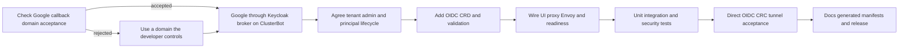

# COST-8520 implementation plan: external OIDC

**Status:** Proposed; depends on the decisions in [DESIGN.md](DESIGN.md)

**Scope:** Provider-neutral OIDC for the on-prem UI and Envoy gateway

**Test environment:** ClusterBot for the current broker baseline; CRC plus a temporary HTTPS tunnel is a fallback. See [CLUSTERBOT-PREP.md](CLUSTERBOT-PREP.md)

## COST-8520 request and proposed acceptance criteria

[COST-8520](https://redhat.atlassian.net/browse/COST-8520) is titled “External OIDC provider as an alternative to Keycloak.” Its description asks to connect Cost Management self-managed directly to external identity providers so customers can remove the Keycloak requirement. The ticket explicitly keeps Insights RBAC as the authorization system and excludes replacing Cost roles with identity-provider roles. The issue is currently **New** and its description has no explicit acceptance-criteria section (checked 2026-11-19).

The following acceptance criteria are proposed for refinement; they are not copied from Jira:

1. An on-prem installation can use an external OIDC provider for UI login without deploying or depending on Keycloak. Existing Keycloak configurations continue to work through upgrade without CR changes.
2. The operator configures the browser callback, oauth2-proxy discovery/client credentials, Envoy issuer/audience/JWKS validation, and explicit identity-claim translation. Missing or invalid tenant identity fails closed.
3. Tenant ID, account number, username, email, and any administrator signal have documented explicit mappings or controlled single-tenant values. Email/domain alone never grants tenant identity or admin privileges.
4. An authenticated user becomes a selectable principal through a documented provider-neutral lifecycle, without receiving a Cost role automatically. A Cost administrator can assign RBAC groups/roles, and a user without an assignment remains denied.
5. A direct-provider end-to-end test demonstrates login, API identity validation, principal visibility, administrator role assignment, and denial before assignment without Keycloak in the request path.
6. The operator documentation includes the CR, Secret, provider callback, readiness, logout limitations, upgrade behavior, and a reproducible test procedure.

The current Google → Keycloak → rbac-mini experiment is compatibility evidence only. Its operator setup and result are in [KEYCLOAK-RBAC-MINI.md](KEYCLOAK-RBAC-MINI.md); it does not satisfy criteria 1 or 5.

## Plan at a glance

The Google-through-Keycloak broker path has now been exercised on ClusterBot using rbac-go; the result is recorded in [CLUSTERBOT-PREP.md](CLUSTERBOT-PREP.md). It proves the broker login and tenant identity path, but the no-role user correctly receives no Cost permissions. Next, settle the customer identity/provisioning contract, implement the additive direct OIDC mode, validate backward compatibility and direct-provider behavior, and publish an operator runbook.

The broker experiment tests the Google Cloud client and current Keycloak flow. It is not direct-provider acceptance and does not close COST-8520.

## Customer-facing setup: operator and rbac-mini responsibilities

**Planning assumption:** COST-8520 targets direct OIDC to a customer's provider,
while existing Keycloak-only installations remain supported. The brokered
Google path is a working compatibility/test path. Confirm whether customers
also need Keycloak to remain a required broker before freezing the public CRD.

| Area | Operator responsibility | rbac-mini / customer responsibility |
|---|---|---|
| IdP client | Validate issuer, audience, TLS settings, callback inputs, and Secret references; render oauth2-proxy OIDC settings and Envoy JWT validation/identity mapping; report provider readiness without logging credentials. | Customer creates the OIDC client in the provider console/API and registers the callback URI emitted for the installation. |
| Cost identity | Expose explicit claim or fixed-value configuration for `org_id` and `account_number`; validate that the selected source is unambiguous. Make admin mapping explicit and default it to false. | Customer maps the identity to the intended tenant and chooses a trusted admin claim or bootstrap procedure. Do not infer tenant or admin from email/domain. |
| RBAC principal | Do not treat OIDC group claims as Cost roles by default. The existing Keycloak sync remains an optional, Keycloak-specific integration. | rbac-mini must define how a non-Keycloak user becomes a selectable principal in User Access. Customer admin assigns Cost RBAC groups and roles after authentication. |
| Secrets and status | Reference client credentials and CA bundles by Secret; never print values. Keep Keycloak-only CRs unchanged and expose clear Ready/NotReady conditions. | Customer creates and rotates provider credentials and controls who can assign roles. |

### Work required before customer OIDC is usable

1. **Freeze the identity contract.** Decide fixed single-tenant values versus claim paths for tenant ID and account number, admin claim shape/value, stable username/subject mapping, and whether service accounts are out of scope. Missing tenant claims fail closed; missing admin claims mean non-admin.
2. **Choose principal onboarding.** The current rbac-go sync calls Keycloak's Admin API, while OIDC defines no user/group provisioning API. Recommended option to evaluate: rbac-mini upserts an active principal from a verified `X-Rh-Identity` on first authenticated use, with the API reachable only behind trusted Envoy and caller-supplied identity headers stripped/overwritten. Preserve a stable external subject, define rename/disable behavior, and do not grant a Cost role during upsert. Compare this with SCIM or a customer-managed import before choosing.
3. **Define bootstrap admin.** Document how the first authorized administrator is selected without making every OIDC user an admin. Require an explicit trusted claim or controlled bootstrap input; keep the default false. Verify that this admin can find the newly provisioned user and assign a Cost role.
4. **Implement operator API and reconciliation.** Add OIDC beside Keycloak rather than changing Keycloak defaults. Configure oauth2-proxy discovery and ID-token forwarding; configure Envoy with exact issuer, audience, JWKS, and identity claims; validate secret/CA references and mutually exclusive modes; expose useful status and stable callback documentation.
5. **Implement and test the rbac-mini lifecycle contract.** Add provider-neutral principal onboarding only after the identity and bootstrap decisions are agreed. Keep role/group authorization in Cost RBAC and test the no-role response as well as a successful admin assignment.
6. **Ship customer docs and compatibility evidence.** Provide sample CRs, provider callback/secret steps, tenant/admin mapping examples, an RBAC admin workflow, upgrade tests for existing Keycloak CRs, and direct-OIDC end-to-end evidence.

### Brokered Google baseline result

Google login through Keycloak succeeded. The user was active in the default on-prem tenant and had no Cost role; the Go API returned an empty permission list and the UI displayed its no-access screen. This confirms that authentication and authorization are separate and that principal synchronization alone does not grant access. Direct OIDC, provider-neutral principal provisioning, and role delegation were not completed by that test.

## Phase 0: settle acceptance and test-domain feasibility

### Work

1. Review the proposed claim/API choices in [DESIGN.md](DESIGN.md) with the COST-8520 owner.
2. Define:
   - Whether orgID and accountNumber come from claims, fixed single-tenant values, or both.
   - How an IdP claim grants org-admin, and which claim types are supported.
   - How first admin and ordinary user principals/groups are created when Keycloak sync is disabled.
   - Whether provider user/group synchronization and service-account tokens are outside v1.
   - Whether generic logout is local-session-only when the IdP has no end-session endpoint.
   - How the callback URL can be overridden for a tunnel and reverse-proxy deployment.
3. In Google Cloud Console, create a test OAuth Web client and confirm the exact callback domain can be registered. Use only openid, email, and profile for the login smoke test, and keep the app in Testing with the test user allowlisted.
4. Prefer an ngrok assigned stable dev hostname if Google accepts it. If Google requires verified domain ownership, use a domain controlled by the developer. Use a Cloudflare Quick Tunnel only for a reachability experiment because its hostname changes between starts.
5. Record the tunnel provider, public hostname, local target, DNS/Host-header behavior, TLS trust, and teardown steps in the run notes. Never store client secrets or tokens in this repository.

### Exit criteria

- COST-8520 acceptance criteria identify the Cost identity mapping and provisioning contract.
- Google Console accepts the redirect domain, or a controlled-domain fallback is selected.
- The direct OIDC callback target is feasible with CRC without exposing cluster-control or data-service endpoints.

### Gate

Do not start the CRD/API implementation while admin mapping and user/principal lifecycle remain undefined. Those choices affect the public API and whether RBAC UI use works after login.

## Phase 1: Google broker baseline through Keycloak

This phase validates Google Console and the Keycloak broker flow without changing operator source. The ClusterBot test did change the CMSC to select rbac-go and run its Keycloak sync; see [CLUSTERBOT-PREP.md](CLUSTERBOT-PREP.md) and the repeatable [Keycloak/rbac-mini setup guide](KEYCLOAK-RBAC-MINI.md). The detailed steps below cover CRC and its tunnel path.

### Setup sequence

1. Bring up the existing CRC full stack using the [CRC testing guide](../development/crc-testing.md). Confirm the local UI and Keycloak Route work before adding the tunnel.
2. Start an outbound tunnel from the laptop to the Keycloak web Route. Use a stable HTTPS hostname if Google accepts it. The browser's redirect back to the CRC UI remains local to the laptop. Restrict forwarded paths to realm login/discovery/broker endpoints and required static resources where the tunnel supports path rules; block /admin and /realms/master, then verify the Admin API is unreachable.
3. Configure a Google OAuth Web client. The authorized redirect URI must exactly match Keycloak's broker endpoint, normally:

       https://<public-keycloak-host>/realms/kubernetes/broker/google/endpoint

   The Google redirect target is Keycloak, not the Cost UI.
4. In the Keycloak kubernetes realm, add Google as an identity provider using the Google client ID and secret. Register the exact callback shown by Keycloak if the realm path differs.
5. Set Keycloak's frontend hostname/issuer to the tunnel hostname. The [RHBK deploy helper](../../scripts/deploy-rhbk.sh#L637-L685) currently derives its hostname from the CRC cluster domain, so apply a temporary Keycloak custom-resource override or add a separate, reviewable helper option. Ensure discovery metadata and the ID token issuer use the same public host. Verify outbound reachability from the UI pod to the public issuer for discovery/code exchange, and from Keycloak to the Google token endpoint.
6. Configure the CMSC issuer to the Keycloak public issuer while keeping Envoy JWKS fetch on the in-cluster Keycloak Service when possible. The UI's callback remains its existing CRC Route callback.
7. In the local Keycloak user/realm, assign synthetic org_id and account_number values to the ordinary Google-linked user and leave its org-admin role unset. Use a separate bootstrap administrator to test role assignment. Google authenticates the upstream account; Keycloak maps it into the existing Cost identity contract.
8. Sign in through the CRC UI and verify the Keycloak-issued ID token, UI session, API requests, and X-Rh-Identity tenant fields. Confirm the unassigned user has no permissions, then use the separate administrator to assign a Cost RBAC role and verify access.
9. Remove the tunnel, restore the original Keycloak hostname and CMSC issuer, and revoke/delete temporary Google client credentials after capturing non-secret results.

### What this proves

- Google OAuth client registration and user consent work for the developer's project.
- A tunnel can reach local Keycloak web endpoints while the CRC UI remains local.
- The existing Keycloak issuer, oauth2-proxy, Envoy, and RBAC claim path can complete an end-to-end UI login.

### What this does not prove

- Direct Google or generic OIDC support in the operator.
- Provider-neutral claim mapping, generic logout, arbitrary group synchronization, or service-account support.
- Google itself provides Cost tenant or org-admin claims.

The current [Keycloak login guide](../install/keycloak.md) describes the realm claim and administrator setup. Keep the result labeled as a broker baseline, not COST-8520 completion.

## Phase 2: finalize API and compatibility contract

### API work

Add a provider-neutral OIDC configuration next to the existing Keycloak configuration. Keep existing Keycloak fields and defaults. Validate that exactly one auth provider is configured. When OIDC is absent, existing Keycloak validation remains unchanged.

The minimal proposed OIDC API contains:

- issuerURL for oauth2-proxy discovery and exact JWT issuer checking.
- jwksURL for Envoy's concrete remote JWKS endpoint; Envoy does not resolve OIDC discovery metadata itself.
- audiences, required and non-empty.
- TLS CA reference and a clearly restricted lab-only insecure option if retained.
- Identity mappings for orgID, accountNumber, username, email, and optional orgAdmin.
- A callback/base URL override only if required for tunnel and reverse-proxy operation. Keep the default callback derived from the UI Route.

Reuse the existing UI OAuth Secret reference for client-id/client-secret unless the design review identifies a requirement for a separate provider client. Never introduce a plaintext client secret in the CR.

### Compatibility rules

- Keycloak-only CR: equivalent generated resources where practical and unchanged login behavior.
- OIDC-only CR: no Keycloak URL or Keycloak Admin API dependency unless Keycloak sync is explicitly enabled.
- Both providers set: admission rejection with a clear field error.
- Missing required issuer/JWKS/audience or tenant mapping: admission rejection.
- Missing/false admin claim: non-admin identity, never implicit admin.
- Keycloak sync: remains an explicitly Keycloak-specific optional component. Document that disabling it leaves no generic provider sync.
- Existing Keycloak Ready/Degraded reasons: preserve them or provide compatible transitions. Generic mode gets provider-neutral messages.

### Exit criteria

The API contract is reviewed, old CRs still validate, generated CRD/bundle output is up to date, and the sample includes no real credential or insecure TLS shortcut.

## Phase 3: operator and data-flow implementation

Work in small changes, keeping generated code and manifests in sync.

### CRD and admission validation

- Extend [CostManagementServiceConfig API types](../../api/v1alpha1/costmanagementserviceconfig_types.go).
- Update [webhook validation](../../api/v1alpha1/costmanagementserviceconfig_webhook.go) and related schema/CEL rules for provider selection, URL shape, non-empty audiences, Secret references, and mapping exclusivity.
- Regenerate deepcopy methods, CRDs, and OLM bundle using the prescribed **make generate**, **make manifests**, and **make bundle** workflow in [AGENTS.md](../../AGENTS.md).

### UI oauth2-proxy

- Update [UIDeployment](../../internal/resources/ui.go) to choose Keycloak OIDC or the generic OIDC provider from the active mode.
- Keep ID-token forwarding to Envoy enabled and confirm behavior with the pinned oauth2-proxy image.
- Wire issuer, client credentials, CA bundle, callback URL, and logout behavior.
- Do not pass secrets in arguments; keep credentials as Secret-backed environment or files.
- Ensure the generated redirect URI exactly matches the IdP registration.

### Envoy and identity normalization

- Generalize the Keycloak-named issuer, JWKS, audience, and TLS helpers in [Envoy resources](../../internal/resources/envoy.go), while preserving Keycloak output for legacy CRs.
- Configure Envoy's JWT provider with explicit issuer, audiences, and JWKS URI. Do not rely on OIDC discovery inside Envoy.
- Replace the hardcoded JWT metadata key and Keycloak role path with a stable provider-neutral configuration path.
- Implement validated claim mapping into the same X-Rh-Identity schema.
- Reject missing or malformed org/account claims before sending upstream. Ensure client-supplied identity headers are overwritten.
- Support only explicitly agreed admin claim forms; false or absent stays false.

### Readiness and conditions

- Generalize [OIDC validation](../../internal/controller/validation.go) to validate the active provider.
- Probe configured JWKS with the configured CA; optionally fetch issuer discovery and verify issuer/JWKS metadata consistency.
- Report AuthenticationReady with provider-neutral reasons for configuration, discovery, TLS, and reachability failures.
- Do not log bearer tokens, client secrets, authorization codes, or sensitive claims.

### Testability for CRC

Add an optional external callback/base URL only if Phase 0 confirms it is necessary. The current callback is derived from the OpenShift Route hostname. A tunnel callback must terminate at oauth2-proxy and preserve state/cookie behavior. Keep other CRC routes private.

## Phase 4: validation matrix

Add focused unit and integration coverage as implementation is written. This is the required validation plan; no tests have been run as part of this design document.

| Area | Required cases |
|---|---|
| Admission | Keycloak-only accepted; OIDC-only accepted; both rejected; missing issuer/JWKS/audience; malformed or insecure URL; invalid TLS Secret; both claim and fixed tenant sources set |
| UI proxy config | Correct generic provider, issuer, client Secret, CA, callback URL, secure cookies, state/nonce behavior, ID token forwarded |
| Envoy JWT | Valid signature/issuer/audience accepted; bad issuer/audience/signature, expired/not-before token, unavailable JWKS rejected |
| Identity mapping | Flat/nested claims; fixed single-tenant values; missing/wrong-type/invalid org/account returns 401; email/username fallback; incoming X-Rh-Identity overwritten |
| Admin authorization | Exact configured value maps true; absent, false, or nonmatching maps false; no email/hd-based privilege |
| TLS | Public CA succeeds; custom CA succeeds; wrong CA fails; insecure skip only in explicitly permitted lab configuration |
| Compatibility | Existing Keycloak Envoy YAML, UI args, readiness, logout, and sync output remain unchanged |
| Principal lifecycle | First admin can reach RBAC UI; regular user can be provisioned/selected/assigned with generic OIDC and sync disabled; behavior documented |
| Direct CRC flow | Google callback reaches public UI tunnel; state cookie survives; UI session works; API ID token reaches Envoy; shutdown removes public reachability |
| Broker baseline | Google-to-Keycloak callback works; Keycloak issuer/in-cluster JWKS split works; synthetic admin identity reaches RBAC |

The generated CRD and bundle rules are in [AGENTS.md](../../AGENTS.md). The implementation must also meet repository link, lint, and test checks before a PR.

## Phase 5: documentation, rollout, and closure

1. Update the [Keycloak install guide](../install/keycloak.md) to label it as the legacy/provider-specific mode and link to a new external OIDC guide.
2. Add a provider-neutral setup guide with IdP client registration and exact callback, issuer/JWKS distinction, client Secret creation, claim mapping examples, safe admin setup, TLS CA setup, logout limits, and optional Keycloak sync.
3. Add a CRC tunnel runbook based on the provider/domain accepted in Phase 0. Include exposure scope, Host rewrite, callback registration, tunnel start/stop, and cleanup.
4. Update sample CMSCs and operator API docs. Keep production examples on verified HTTPS with TLS validation enabled.
5. Validate upgrade from an existing Keycloak-only CR and a new install with an OIDC-only CR.
6. Attach test evidence and remaining limitations to COST-8520. Update COST-8430 only if its owner agrees the scope overlaps.

## Risks and mitigations

| Risk | Mitigation |
|---|---|
| Google OAuth rejects a tunnel-owned domain | Verify registration first; use a domain controlled by the developer if required |
| Generic IdP lacks org/account/admin claims | Require explicit mapping or single-tenant values; default admin false |
| RBAC UI has no generic principal provisioning path | Resolve lifecycle in Phase 0; do not claim UI readiness until tested |
| Envoy JWKS and oauth2-proxy discovery disagree | Explicit JWKS URL plus discovery consistency check and issuer/audience tests |
| Tunnel exposes unrelated cluster services | Forward only the UI or Keycloak web endpoint; test with synthetic data; stop after test |
| Existing installations break due to provider-selection rules | Preserve Keycloak-only defaults and test an existing CR through upgrade |
| Provider logout differs | Use discovered end-session support where available; otherwise document local-only logout |
| Keycloak-specific status names leak into generic mode | Add provider-neutral readiness reasons while preserving legacy behavior |

## Completion checklist

- [ ] COST-8520 owner agrees on tenant/admin claim and principal lifecycle behavior.
- [ ] Google test hostname is accepted or a controlled-domain fallback is chosen.
- [ ] Broker baseline is recorded separately from direct-provider support.
- [ ] OIDC API is additive and Keycloak-only CRs remain compatible.
- [ ] oauth2-proxy uses provider OIDC discovery and passes the ID token.
- [ ] Envoy validates exact issuer, audience, signature, and explicit JWKS.
- [ ] Missing tenant claims fail closed; admin defaults false.
- [ ] Generic OIDC user/principal workflow is demonstrated with Keycloak sync disabled.
- [ ] CRC direct-OIDC tunnel flow and cleanup are documented and exercised.
- [ ] CRD, generated code, bundle, tests, and install docs are updated.
- [ ] COST-8520 is updated with evidence and agreed scope complete.
